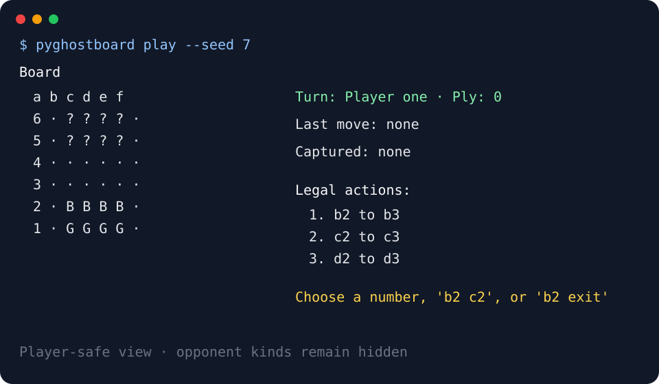

# pyghostboard

[](https://github.com/satter0827/pyghostboard/actions/workflows/ci.yml)
[](https://github.com/satter0827/pyghostboard/blob/main/LICENSE)

pyghostboard is one typed Python package for playing Geister, embedding its domain, building
process-isolated AIs, and analyzing reproducible AI matches.

[日本語版 README](README.ja.md)

## Play

Python 3.11 through 3.14 is supported. The domain API is portable Python. The CLI, isolated AI
processes, and private records require macOS or Linux for POSIX process cleanup and file handling.

```shell
git clone https://github.com/satter0827/pyghostboard.git
cd pyghostboard
python -m pip install .
pyghostboard play --seed 7
```

MCTS is the default opponent; use `--agent random` for the reproducible baseline. Enter a displayed
number, `b2 c2`, or `b2 exit` when choosing an action. Use `--language ja` or
`PYGHOSTBOARD_LANGUAGE=ja` for Japanese.



A capable TTY gets one updating Rich screen. Redirected output, `NO_COLOR`, and `TERM=dumb` use
append-only plain text. Replay a private record from either player viewpoint with optional step or
automatic progression:

```shell
pyghostboard replay match.jsonl --view two --step
pyghostboard replay match.jsonl --view one --delay 0.5
```

Private records contain both players' ghost kinds and placements. Store them as secrets. Existing
record destinations are replaced only with explicit `--overwrite-record`.

## Use the domain API

```python
from uuid import uuid4

from pyghostboard.domain import Match, Placement, Player, RuleSet

rules = RuleSet.standard()
one = rules.start_squares(Player.ONE)
two = rules.start_squares(Player.TWO)
match = Match.start(
    uuid4(),
    rules,
    {
        Player.ONE: Placement(good=one[:4], bad=one[4:]),
        Player.TWO: Placement(good=two[:4], bad=two[4:]),
    },
)
view = match.view_for(Player.ONE)
match = match.play(Player.ONE, view.legal_actions[0]).match
```

Trusted applications can use immutable domain values directly or coordinate persisted matches with
`MatchService`, `MatchRunner`, and the injected `MatchStore` and `PlayerController` ports. Public
facades are typed, and versioned JSON Schemas are bundled in the wheel.

## Build an AI

The smallest external AI can reuse the public policy runner:

```python
import sys

from pyghostboard.agents import RandomAgent, run_agent

run_agent(sys.stdin.buffer, sys.stdout, RandomAgent)
```

Save it as `agent.py`, validate its complete lifecycle, then play against it. Every command argument
is repeated and passed directly without a shell:

```shell
pyghostboard agent check --command python --command agent.py
pyghostboard play --command python --command agent.py
```

The host sends only public rules, the assigned player's view, legal actions, seed, and lifecycle
messages. AI wire schema 0.1.0 never contains private snapshots, events, or opposing live ghost
kinds. See the runnable [`examples/external_agent.py`](examples/external_agent.py).

## Analyze matches

[`examples/arena.toml`](examples/arena.toml) explicitly declares two AIs, rounds, root seed, rules,
search settings, execution limits, and the watch viewpoint.

```shell
pyghostboard watch examples/arena.toml
pyghostboard arena examples/arena.toml --output results/
pyghostboard analyze results/
pyghostboard analyze results/ --format json
```

Each round swaps the two AIs between player one and player two. Seeds are derived from the root
seed, round, and AI identifier with SHA-256. The private `0700` result directory stores one existing
private match record per successful game plus versioned manifest and result files. Analysis reports
completion and failure counts, AI and side win rates, victory reasons, and average plies. These are
descriptive statistics; pyghostboard does not claim statistical significance.

## Development

```shell
uv sync --locked --group dev
uv run python scripts/release_gate.py check all
```

See the [documentation](docs/README.md) for requirements, architecture, interfaces, quality,
delivery, and operations. [Contributing](CONTRIBUTING.md) describes the review and branch workflow.

## Release scope

The 0.1 series covers local human-versus-AI play, reusable domain and application APIs, external AI
processes, private match recording, deterministic arenas, and descriptive analysis. GUI, network
matchmaking, accounts, production database adapters, and package-registry publication are outside
this scope.

This is an unofficial implementation. It does not include commercial artwork or rulebook text.

## License

Licensed under the [MIT License](LICENSE).
